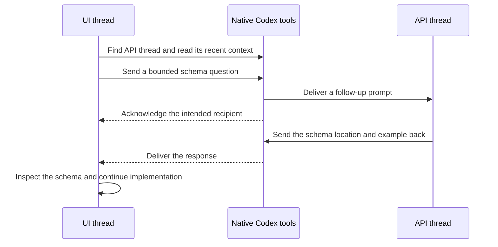

# Codex Thread Coordination

**Keep several Codex threads live. Let them talk.**

A Codex skill for discovering existing sessions, exchanging focused handoffs,
and checking what happened afterward through native `codex_tui` tools.

Keep an implementation thread, a review thread, and a research thread open at
the same time. Each keeps its own conversation and working context. When one
needs an answer or produces something another needs, it can find that thread,
read its recent work, and send a follow-up directly.

You can direct the work without copying every question and answer between chats.

> Requires a Codex environment that exposes the native `codex_tui` tools.
> Installing the skill does not install or enable those tools.

## Why multiple live threads are useful

- **Keep context focused.** Implementation, investigation, and review can each
  keep their own working history and decisions.
- **Advance independent work in parallel.** A reviewer can inspect a completed
  change while another thread works on the next independent task.
- **Ask the thread that has the context.** Send a specific question to the
  session that investigated the issue, with enough detail for it to answer.
- **Reduce manual relaying.** Threads exchange questions, blockers, and artifact
  locations through the native sender.
- **Keep ownership visible.** Handoffs state the requested action and file
  boundaries so two sessions do not silently take over the same work.
- **Make delivery claims precise.** The skill distinguishes a sender accepting
  a message, a recipient acting on it, and an artifact passing validation.
- **Recover after reconnects.** The recovery guide explains how to check for a
  missing sender and use a live context that exposes it.

Parallel work helps when tasks are independent. Shared files still need clear
ownership, and concurrent processes still consume your machine's resources.
This skill adds a communication procedure; your runtime controls scheduling.

## A workflow you can try

Open and name three Codex sessions on the same app server:

| Thread | Responsibility |
| --- | --- |
| API implementation | Implement the API change in its worktree. |
| UI implementation | Build the interface in a separate worktree. |
| Review | Inspect completed changes and report specific defects. |

In the UI thread, ask:

```text
Use $codex-thread-coordination to ask the API implementation thread for
the current response schema and example payload. Keep UI changes in this
worktree. Verify the response against the referenced schema before using it.
```



Each direction uses the same discovery and acknowledgment procedure. A reply
depends on the recipient acting; the skill does not guarantee a response.

See [workflow examples](examples/workflows.md) for review handoffs, blocked work,
and an optional `AGENTS.md` rule.

## What native features it uses

| Native feature | How the skill uses it |
| --- | --- |
| `codex_tui.list_threads` | Discover recent threads on the current app server. |
| `codex_tui.read_thread` | Confirm the recipient's context and inspect subsequent activity. |
| `codex_tui.list_archived_threads` | Find a recipient in archived history when needed. |
| `codex_tui.send_message_to_thread` | Send a follow-up prompt to an existing thread in the background. |
| `codex_tui.wait_threads`, when available | Wait for relevant activity or a terminal state without repeated polling. |
| Native sender result | Verify acceptance for the intended recipient ID. |
| Local app-server control socket | Optional recovery helper calls the installed native tools through a live TUI context. |

The same native tool family can expose thread creation, forking, renaming, and
archiving. This skill focuses on communication between existing threads.
It does not create another workstream or change a recipient's model by default.

The inspected sender schema limits a prompt to **1,000 UTF-8 bytes**. Check the
live schema on your installation. Put large artifacts in the workspace and
send their location with a concise description. Include a revision or digest
when the recipient needs to distinguish versions.

## Install

Ask Codex:

```text
Use $skill-installer to install the skill from
https://github.com/Vuk97/codex-thread-coordination
```

Or inspect and install the files yourself:

```bash
git clone https://github.com/Vuk97/codex-thread-coordination.git
cd codex-thread-coordination
bash install.sh
```

The installer copies the skill and its supporting resources to
`~/.agents/skills/codex-thread-coordination`, the user skill location documented
in [Codex Build skills](https://learn.chatgpt.com/docs/build-skills). It refuses
to overwrite an existing installation. Select another skill directory with:

```bash
bash install.sh --dest .agents/skills/codex-thread-coordination
```

For an installation that uses the legacy Codex skill location, pass
`--dest "${CODEX_HOME:-$HOME/.codex}/skills/codex-thread-coordination"`.
Install in one discovery location to avoid duplicate skill entries.

Codex detects skill changes automatically. If the skill does not appear,
restart Codex. Invoke it as `$codex-thread-coordination`, or ask Codex to
coordinate with another live session.

The primary workflow needs only the Markdown skill and native tools. Python
and `websockets` are required only for the optional recovery helper.

## The failure that prompted the recovery guide

In a recorded Codex **0.159.3** installation, reconnecting a terminal interface
with explicit `--remote` access exposed read/status tools but omitted the
approval-gated native sender. Listing threads worked while sending did not.
Enabling `agent_message_board` did not restore the sender. A normal local TUI
launch registered the sender through the same app server.

The skill preserves that diagnosis and a recovery procedure. It also prevents
an agent from treating a local note as delivered, choosing a recipient from an
old ID alone, or claiming integration from a successful send.

The recovery procedure is **version-specific and experimental**. Native tool
availability and internal app-server methods can change. Check your live
registry before relying on them. See [native sender recovery](references/native-sender-recovery.md).

## What a successful handoff proves

| Observation | Supported claim |
| --- | --- |
| Sender accepts the exact recipient ID | The native sender accepted the handoff. |
| Recipient thread shows relevant activity or a reply | The recipient received or acted on the request. |
| Referenced change is inspected and validated | The work supports the tested result. |
| Client loses its acknowledgment | Delivery remains `UNKNOWN`; inspect before retrying. |

Messages are follow-up prompts that can trigger work. They inherit no new
permission to publish, deploy, merge, or touch unrelated files. Coordination
uses authorization already present in the user's task.

## Compatibility and privacy

- Requires native `codex_tui` tools and recipients visible on the same app
  server. Tool names here come from inspected live schemas, not a promise of
  availability in every Codex client.
- A read-only live check from Codex CLI 0.160.0 confirmed the helper could reach
  a connected registry exposing all nine tools, including the sender. This
  checks registry access; it does not establish delivery on every installation.
- Designed for Codex. Other agents can read the Markdown, but need equivalent
  native capabilities to perform the workflow.
- Adds no separate hosted service, telemetry, or API-key setup. Codex's own
  authentication, approvals, and usage still apply.
- The optional helper connects to a local Unix socket. It prints requested
  thread data locally. Treat those outputs and handoff files as private.
- Examples are fictional. This repository contains no real session IDs,
  conversation exports, home-directory paths, or private project artifacts.

For the general platform concepts, see [Codex App Server](https://learn.chatgpt.com/docs/app-server)
and [OpenAI skills](https://developers.openai.com/plugins/concepts/skills).

## Contribute

Run the focused helper and installer tests before changing behavior:

```bash
python3 -m unittest discover -s tests -v
git diff --check
```

For compatibility reports, include the Codex version, launch mode, available
tool names, and a redacted error. Remove thread IDs, transcripts, local paths,
and secrets before posting. See [CONTRIBUTING.md](CONTRIBUTING.md).

## License

MIT. See [LICENSE](LICENSE).
